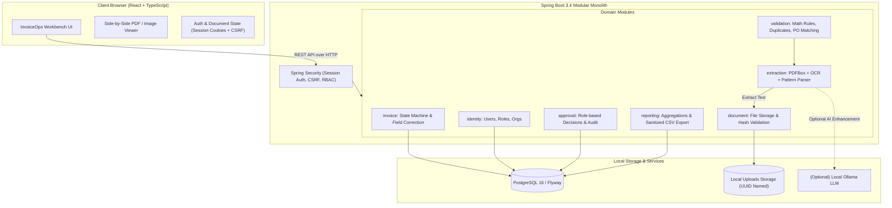
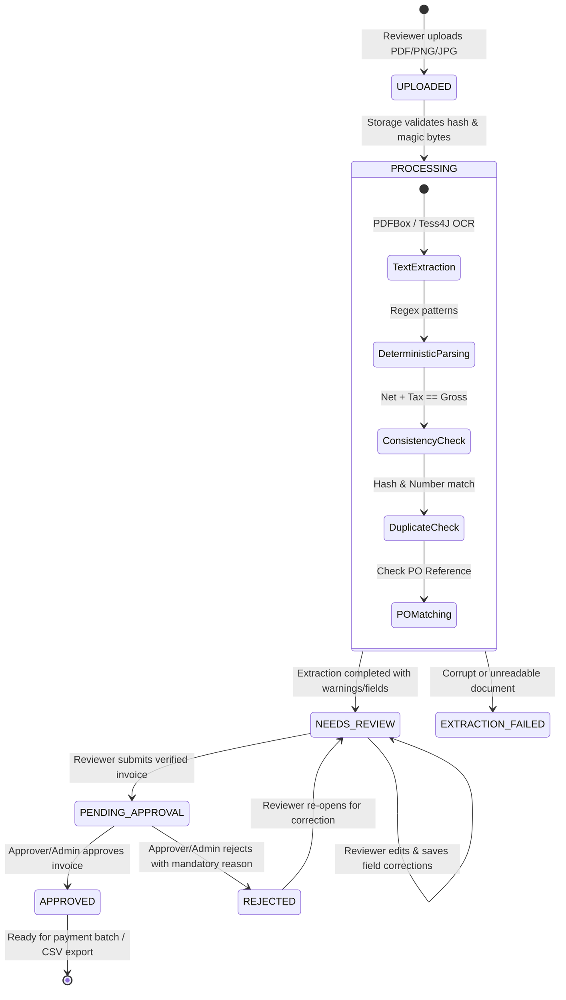
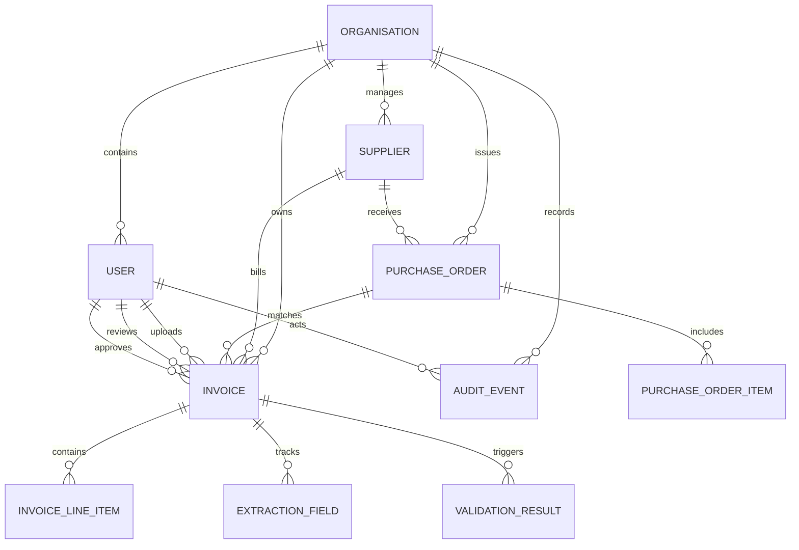
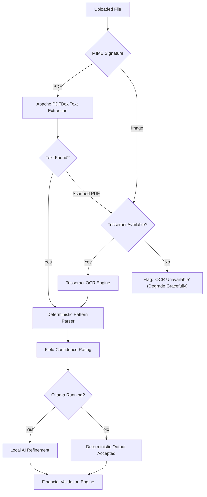

# InvoiceOps

[](https://github.com/PremKLodhia/invoiceops/actions)
[](LICENSE)
[](https://www.oracle.com/java/)
[](https://spring.io/projects/spring-boot)
[](https://react.dev/)
[](https://www.typescriptlang.org/)
[](https://www.postgresql.org/)
[](#non-negotiable-requirement-total-cost-must-be-zero)

A **local-first, AI-assisted invoice operations platform** for small businesses, charities, and finance teams. Built with a modular Spring Boot 3 monolith, React + TypeScript workbench, deterministic document extraction pipeline, and an auditable approval workflow.

---

## Table of Contents

- [1. Project Purpose & Problem Statement](#1-project-purpose--problem-statement)
- [2. Feature Overview](#2-feature-overview)
- [3. Technology Stack](#3-technology-stack)
- [4. Architecture Diagram](#4-architecture-diagram)
- [5. Walkthrough of the Main Invoice Workflow](#5-walkthrough-of-the-main-invoice-workflow)
- [6. Data Model & Business Rules](#6-data-model--business-rules)
- [7. Local Setup Instructions](#7-local-setup-instructions)
- [8. Starting & Stopping the System](#8-starting--stopping-the-system)
- [9. Demo Credentials & Seeded Data](#9-demo-credentials--seeded-data)
- [10. Executing the Test Suite](#10-executing-the-test-suite)
- [11. Document Extraction & Resilient Fallback](#11-document-extraction--resilient-fallback)
- [12. Security & Privacy Architecture](#12-security--privacy-architecture)
- [13. Known Limitations](#13-known-limitations)
- [14. Roadmap](#14-roadmap)
- [15. License & Attribution](#15-license--attribution)
- [16. Architecture Decision Records (ADRs)](#16-architecture-decision-records-adrs)

---

## 1. Project Purpose & Problem Statement

Small businesses, charities, and growing finance teams process hundreds of supplier invoices each month. Most of these arrive as PDF attachments, scanned receipts, or photographs.

Common operational bottlenecks include:
- **Manual Data Re-entry**: Accounts payable clerks manually type numbers from PDFs into spreadsheets.
- **Silent Duplicates**: Invoices sent multiple times (e.g. by email and post) are paid twice.
- **PO Discrepancies**: Invoiced amounts exceed authorized purchase order budgets unnoticed.
- **Arithmetic Inconsistencies**: Rounding differences and subtotal errors cause tax misreporting.
- **Disorganized Approvals**: Approvals occur in informal email threads with zero audit history.

**InvoiceOps solves this end-to-end.** It automates data extraction, flags mathematical anomalies and duplicate filings, matches against purchase orders, and guides reviewers and approvers through a strictly auditable state machine.

### Core Product Principle

> **Automation assists people; it does not silently make financial decisions.**
>
> An invoice is never auto-approved simply because an OCR or AI parser reports high confidence. Missing or uncertain fields are transparently flagged with confidence indicators, and human financial reviewers retain final authority.

---

## 2. Feature Overview

| Capability | Implementation |
|---|---|
| **Local-First & Zero-Cost** | Runs 100% on local hardware. Zero cloud subscriptions, zero external paid APIs. |
| **Pluggable Document Extraction** | Apache PDFBox native text extraction with optional Tesseract OCR and optional Ollama AI enhancement. |
| **Deterministic Parsing** | Resilient regex and pattern parser with field-level confidence ratings (`HIGH`, `MEDIUM`, `LOW`, `UNVERIFIED`). |
| **Financial Consistency Engine** | Automated validation verifying `Net Subtotal + Tax == Gross Total` within floating-point tolerance. |
| **Duplicate Detection** | Proactive warning triggers on matching normalized invoice numbers, suppliers, or cryptographic file hashes. |
| **2-Way Purchase Order Matching** | Validates invoice line items and totals against authorized PO limits and supplier identities. |
| **Interactive Review Workspace** | Split-screen desktop workbench rendering document preview alongside editable extracted fields. |
| **Auditable Approval Workflow** | Strict server-side state machine (`UPLOADED` &rarr; `NEEDS_REVIEW` &rarr; `PENDING_APPROVAL` &rarr; `APPROVED` / `REJECTED`). |
| **Append-Only Audit Trail** | Application-level append-only event store capturing actor, timestamp, action, and structured delta metadata. |
| **Multi-Tenant Org Isolation** | Verified organization boundary enforcement preventing cross-tenant document or invoice access. |
| **Multi-Currency Reporting** | Subtotals grouped strictly by ISO currency code (`GBP`, `USD`, `EUR`) without blending distinct currencies. |
| **Safe CSV Export** | Spreadsheet formula injection mitigation (CWE-1236) sanitizing formula-triggering characters. |
| **User Administration** | Role-based team management (`/users`) for administrators with status activation/deactivation and self-deactivation protection. |
| **Demo Mode with Seeded Fixtures** | Repeatable synthetic dataset showcasing clean, duplicate, mismatch, arithmetic error, and OCR invoices. |

---

## 3. Technology Stack

### Backend
- **Java 21 LTS** with modern Java records, pattern matching, and virtual threads support.
- **Spring Boot 3.4.2** (Web, Data JPA, Security, Actuator, Validation).
- **Apache PDFBox 3.0.4** for high-performance direct PDF text and metadata extraction.
- **Tess4J 5.14.0** (Tesseract OCR wrapper) with graceful degradation when native OCR binaries are absent.
- **Flyway** version-controlled database migrations for PostgreSQL schema.
- **Springdoc OpenAPI 2.8.5** (Swagger UI at `/api/swagger-ui`).
- **PostgreSQL 16** (production / local Docker) + **H2 Database** (zero-dependency local development and automated test suite).

### Frontend
- **React 19** (`^19.2.8`) with **TypeScript 6** in strict mode (`strict: true`, `noImplicitAny: true`).
- **Vite 8** (`^8.3.0`) for sub-second hot module reloading and optimized production bundling.
- **React Router 7** (`^7.18.4`) for secure protected route handling and split-view navigation.
- **Custom Finance Workbench Design System** (Tokens-based CSS Modules, warm off-white surface, deep navy navigation, system typography).
- **Lucide React** for lightweight, consistent operational iconography.
- **Playwright** (`^1.64.1`) for browser end-to-end integration and anti-simulation regression testing.

### Infrastructure & Tooling
- **Docker & Docker Compose** for containerized PostgreSQL service and healthcheck verification.
- **Maven Wrapper (`mvnw` / `mvnw.cmd`)** for reproducible builds without system Maven installations.
- **GitHub Actions** running automated backend tests, TypeScript validation, and production builds on push.

---

## 4. Architecture Diagram



---

## 5. Walkthrough of the Main Invoice Workflow



1. **Upload**: User drags invoice into upload zone. System validates MIME signature, enforces 10MB limit, generates SHA-256 hash, and saves file with UUID name.
2. **Automated Extraction**: PDFBox extracts embedded text stream. Deterministic parser matches supplier, invoice number, dates, currency, line items, and totals.
3. **Consistency & Duplicates**: Rules check mathematical integrity (`Net + Tax == Gross`). Duplicate detection checks existing records. PO matching checks order reference.
4. **Human Review**: Reviewer inspects side-by-side document preview, edits any missing or low-confidence fields, and clicks *Save Changes*.
5. **Submission**: Reviewer submits for approval. State transitions to `PENDING_APPROVAL`.
6. **Authorization**: Approver checks details and either clicks *Approve* or supplies a reason and clicks *Reject*.
7. **Audit & Export**: Every step is recorded in the append-only audit event log. Authorized finance admins export approved records to formula-sanitized CSV.

---

## 6. Data Model & Business Rules

### Core Entities & Relationships



### Important Business Rules

1. **Strict Multi-Tenant Isolation**: All database queries filter by `organisation_id` obtained from the verified server-side security context. Cross-organization access attempts return HTTP 403/404.
2. **Permission Boundary**:
   - `REVIEWER`: Uploads, inspects, corrects fields, submits invoices.
   - `APPROVER`: Reviews submitted invoices, approves or rejects with mandatory rationale.
   - `ADMIN`: Manages organisation settings, users, suppliers, and can approve.
3. **Immutability of Decisions**: Approved or rejected invoices cannot be modified without state re-opening logged in the audit trail.
4. **Rounding Tolerance**: Financial consistency equations use a standard business tolerance of $\pm 0.05$ to prevent false positives from fractional VAT rounding.
5. **No Mixed-Currency Aggregations**: Dashboard metrics aggregate and display gross amounts grouped strictly by ISO currency code (`GBP`, `USD`, `EUR`). Currencies are never blended.

---

## 7. Local Setup Instructions

### Prerequisites
- **Java 21 LTS** or newer (OpenJDK, Temurin, or Oracle JDK).
- **Node.js 20+** and **npm 10+**.
- **Docker Desktop** (optional for PostgreSQL; H2 in-memory mode supported).
- **Git**.

### 1. Clone Repository
```bash
git clone https://github.com/PremKLodhia/invoiceops.git
cd invoiceops
```

### 2. Configure Environment
Copy the environment template:
```bash
# Windows PowerShell
Copy-Item .env.example .env

# Linux / macOS
cp .env.example .env
```

### 3. Database Runtime Modes

InvoiceOps supports two distinct, reliable database modes:

#### Option A: Zero-Dependency Local Mode (H2) — Recommended for Quick Demo
No Docker or PostgreSQL installation required. Uses an embedded file-backed database in PostgreSQL compatibility mode:
```powershell
.\scripts\run-dev.ps1 -Database h2
```

#### Option B: Production-Like Mode (PostgreSQL + Flyway)
Runs PostgreSQL 16 via Docker Compose and executes all versioned Flyway migrations (`V1__initial_schema.sql`):
```powershell
.\scripts\run-dev.ps1 -Database postgres
```

---

## 8. Starting & Stopping the System

### Automated Start (Windows PowerShell)
```powershell
# Default: Zero-dependency H2 mode
.\scripts\run-dev.ps1

# Or explicitly select the database engine:
.\scripts\run-dev.ps1 -Database h2
.\scripts\run-dev.ps1 -Database postgres
```

### Manual Start

#### Backend (Terminal 1)
```bash
cd backend

# Option A: Zero-dependency H2 mode
.\mvnw.cmd spring-boot:run "-Dspring-boot.run.profiles=dev,h2"

# Option B: PostgreSQL mode (ensure docker compose up -d is running)
.\mvnw.cmd spring-boot:run "-Dspring-boot.run.profiles=dev,postgres"
```
Backend API will be available at `http://localhost:8080`.
Swagger OpenAPI documentation will be at `http://localhost:8080/api/swagger-ui`.

#### Frontend (Terminal 2)
```bash
cd frontend
npm install
npm run dev
```
Frontend workbench will be available at `http://localhost:5173`.

### Stopping the Services
- Stop the applications: `Ctrl + C` in each terminal window.
- Stop the PostgreSQL container (if used):
  ```bash
  docker compose -f infra/docker-compose.yml down
  ```

---

## 9. Demo Credentials & Seeded Data

InvoiceOps includes an explicit **Demo Mode** (`APP_DEMO_MODE=true` in `.env` or `application.yml`). When enabled, realistic synthetic data is automatically seeded on startup.

### Demo User Accounts

| Role | Email Address | Password | Permissions |
|---|---|---|---|
| **Administrator** | `admin@invoiceops.local` | `DemoAdmin2026!` | User management (`/users`), settings, review, approval |
| **Reviewer** | `reviewer@invoiceops.local` | `DemoReviewer2026!` | Upload, field correction, submission |
| **Approver** | `approver@invoiceops.local` | `DemoApprover2026!` | Review submitted invoices, approve, reject |
| **Tenant 2 (Audit)** | `zenith_user@zenith.local` | `DemoZenith2026!` | Isolated second organization account |

> **Security Note:** Demo credentials and mock seeders are strictly disabled by default when `APP_DEMO_MODE=false`.

### Labelled Sample Documents (`sample-data/`)

Seven pre-generated synthetic invoices demonstrate all operational scenarios:

1. `01_standard_clean.pdf` — Apex Cloud Technologies Ltd (Valid PO match, clean VAT).
2. `02_scanned_receipt.png` — Metro Logistics Services (Scanned image for OCR pipeline).
3. `03_missing_fields.pdf` — Northwind Facilities (Missing PO reference & due date).
4. `04_duplicate_invoice.pdf` — Duplicate of `01` to trigger duplicate detection warning.
5. `05_po_mismatch.pdf` — Apex Cloud Technologies (Gross exceeds PO limit by £1,300.00).
6. `06_math_discrepancy.pdf` — Meridian Stationery (Subtotal £500 + Tax £100 $\neq$ Gross £750).
7. `07_corrupt_file.pdf` — Intentionally malformed file to test upload error recovery.

---

## 10. Executing the Test Suite

All quality gates can be executed locally with a single script:

```powershell
.\scripts\run-tests.ps1
```

### 1. Backend Tests (Spring Boot 3.4 + JUnit 5 + MockMvc)
```bash
cd backend
.\mvnw.cmd clean test
```
**Test Slices Covered (39 tests, 0 failures, 0 errors):**
- `AuthenticationAndRbacTest`: Form login, session cookies, CSRF protection, role restrictions.
- `UserManagementTest`: Administrator user creation, RBAC checks (403 for Reviewers), self-deactivation prevention, cross-org isolation.
- `OrganisationIsolationTest`: Cross-tenant security boundaries on invoices and file downloads.
- `DeterministicParserTest`: Regex pattern extraction across varying date and currency formats.
- `FinancialValidationTest`: Math rules, VAT tolerances, duplicate warnings, and PO discrepancies.
- `InvoiceStateMachineTest`: Enforcing permitted and illegal lifecycle status transitions.
- `MixedCurrencyReportingTest`: Ensuring multi-currency datasets are strictly isolated and never combined.
- `CsvFormulaInjectionTest`: Verifying sanitization of spreadsheet formula injection vectors (`=`, `+`, `-`, `@`, `\t`, `\r`, newlines, quotes).

### 2. Frontend Checks & Production Build
```bash
cd frontend
# TypeScript strict check
npx tsc --noEmit

# Production build (Vite 8)
npm run build
```

### 3. Browser End-to-End Tests (Playwright)
```bash
cd frontend
npm run test:e2e
```
**Playwright Test Suites (9 tests, 0 failures):**
- `auth.spec.ts`: Login page rendering, invalid credentials error alert, successful session redirect.
- `workflow.spec.ts`: Invoice queue multi-currency grouping, review page field correction, and admin user management.
- `error-handling.spec.ts`: Anti-simulation verification (failed save NEVER displays "All changes saved", failed workflow submit NEVER alters status badge, failed CSV export displays error and avoids unsanitized download).

---

## 11. Document Extraction & Resilient Fallback

InvoiceOps employs a **multi-tiered extraction pipeline** designed to operate without paid APIs:



- **Offline Independence**: The application works completely without external network access.
- **Graceful Degradation**: If Tesseract is not installed on the host OS, image invoices are flagged with an informative badge and remain editable manually.
- **Untrusted Input**: Document text is never treated as executable prompt instructions.

---

## 12. Security & Privacy Architecture

- **Multi-Tenant Scoping**: All invoice records, audit events, and file blobs are partition-locked by `organisation_id`.
- **Directory Traversal Prevention**: Uploaded files are assigned cryptographic UUID filenames (`UUID.randomUUID()`) and verified against the canonical upload path.
- **Signature Validation**: Uploads are inspected for magic byte signatures (`%PDF-`, `\x89PNG`, `\xFF\xD8\xFF`), ignoring file extension spoofing.
- **Password Security**: Passwords hashed with standard `BCryptPasswordEncoder` (strength 10).
- **CSRF & CORS**: Cookie-based CSRF protection (`CookieCsrfTokenRepository`) with strict CORS origins restricted to the frontend workbench.
- **Formula Injection Defense**: Fields written to CSV starting with `=+-@\t\r` are prefixed with an ASCII single quote (`'`).

---

## 13. Known Limitations

- **Three-Way Matching**: Current PO matching performs 2-way verification (Invoice $\leftrightarrow$ Purchase Order). Goods Receipt Note (GRN) matching is not yet implemented.
- **Complex Multi-Page OCR**: Scanned documents with tilted orientation or handwriting require manual field confirmation.
- **Single Currency per Invoice**: While the system supports GBP, USD, and EUR, mixed-currency line items on a single document are not supported.

---

## 14. Roadmap

- [ ] **Goods Receipt Matching**: Support 3-way matching against warehouse receipt notes.
- [ ] **Webhook Notifications**: Real-time Slack/Teams alerts when approval thresholds are exceeded.
- [ ] **E-Invoicing Standard**: Export to Peppol BIS 3.0 XML format for European compliance.
- [ ] **Batch Processing**: Background ZIP archive ingestion for bulk historical scanning.

---

## 15. License & Attribution

Distributed under the **MIT License**. See [`LICENSE`](LICENSE) for details.

### Third-Party Open Source Libraries
- [Spring Boot](https://spring.io/projects/spring-boot) (Apache-2.0)
- [Apache PDFBox](https://pdfbox.apache.org/) (Apache-2.0)
- [Tess4J](https://tess4j.sourceforge.net/) (Apache-2.0)
- [React](https://react.dev/) & [Vite](https://vite.dev/) (MIT)
- [Lucide Icons](https://lucide.dev/) (ISC)

---

## 16. Architecture Decision Records (ADRs)

- [ADR-001: Modular Monolith Architecture](docs/adr/001-modular-monolith.md)
- [ADR-002: Deterministic Extraction with Optional AI](docs/adr/002-deterministic-extraction.md)
- [ADR-003: Session-Based Authentication](docs/adr/003-session-auth.md)
- [ADR-004: Local Filesystem Document Storage](docs/adr/004-local-file-storage.md)
- [ADR-005: Multi-Tenant Organisation Data Isolation](docs/adr/005-organisation-isolation.md)
- [ADR-006: Safe CSV Export with Formula Injection Mitigation](docs/adr/006-csv-formula-injection.md)
