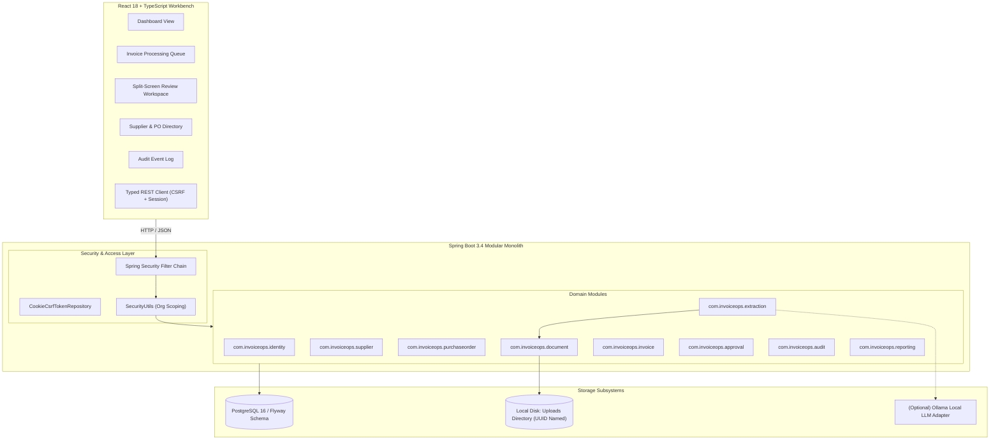
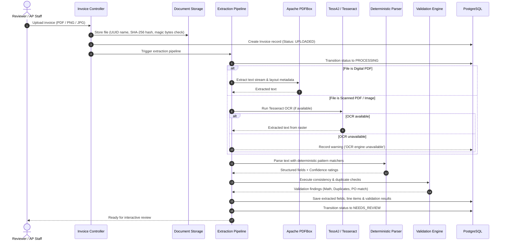
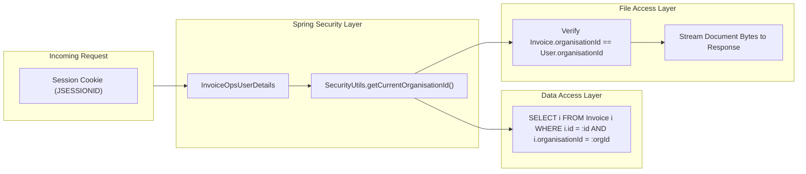

# InvoiceOps Technical Architecture & Design Specification

## 1. System Overview

**InvoiceOps** is structured as an enterprise-grade modular monolith adhering to Domain-Driven Design (DDD) principles. It is engineered to process incoming vendor invoices, extract financial structured data deterministically, flag arithmetic inconsistencies or duplicates, perform two-way matching against purchase orders, and guide records through an auditable approval workflow.

---

## 2. Pluggable Extraction Pipeline

The document extraction engine is architected as an extensible pipeline that favors local, deterministic accuracy first and graceful degradation over fragile cloud dependencies.

### Deterministic Field Extraction Rules

1. **Supplier Matching**: The parser normalizes text against known suppliers registered in the current organization. If an exact or fuzzy match ($\ge 85\%$ token similarity) is identified, `supplier_id` is linked automatically with `HIGH` confidence. Otherwise, the top prominent header lines are assigned as `supplier_name_extracted` with `MEDIUM` confidence.
2. **Invoice Number**: Pattern matcher scans for standard prefixes:
   - `(?:Invoice|INV|Bill|Facture)[\s#.:-]*([A-Za-z0-9\-_/]{3,30})`
   - Validated against length and alphanumeric character entropy.
3. **Dates**:
   - Matches ISO 8601 (`YYYY-MM-DD`), UK standard (`DD/MM/YYYY`), and formatted (`DD Mon YYYY`).
   - Validates that `due_date >= invoice_date` if both are present.
4. **Currency**: Scans symbol markers (`£`, `$`, `€`) and standard ISO 4217 currency trigrams (`GBP`, `USD`, `EUR`). Defaults to the organisation's primary currency if ambiguous.
5. **Amounts & Taxes**:
   - Detects keyword anchors (`Subtotal`, `Net`, `VAT`, `Tax`, `Total`, `Gross`, `Amount Due`).
   - Normalizes comma/dot thousands and decimal separators into standard Java `BigDecimal`.
   - Tracks line items through tabular regex scanning (`Description`, `Qty`, `Unit Price`, `Total`).

---

## 3. Financial Consistency & Validation Engine

Financial validation rules protect accounting integrity by catching errors before invoices reach the approver:

| Validation Rule | Severity | Condition Checked | Resolution Workflow |
|---|---|---|---|
| `MATH_CONSISTENCY` | `ERROR` / `WARNING` | $\|(\text{Net} + \text{Tax}) - \text{Gross}\| > 0.05$ | Reviewer inspects discrepancy banner, adjusts line items or totals, and saves. |
| `LINE_ITEMS_SUM` | `WARNING` | $\|\sum(\text{Line Items}) - \text{Net}\| > 0.05$ | Prompts reviewer to check whether delivery fees or discounts were omitted. |
| `DUPLICATE_NUMBER` | `WARNING` | Existing record exists with same `(org_id, supplier_id, invoice_number)` | Reviewer inspects linked historical invoice to confirm if it is a re-submission. |
| `DUPLICATE_HASH` | `WARNING` | Existing record exists with identical `file_hash` | Reviewer confirms whether file was re-uploaded accidentally. |
| `PO_NOT_FOUND` | `WARNING` | Extracted `PO Reference` does not exist in the organization | Allows reviewer to correct PO number or unlink if non-PO invoice. |
| `PO_SUPPLIER_MISMATCH` | `WARNING` | Invoice supplier does not match purchase order supplier | Flags vendor misattribution for approval verification. |
| `PO_AMOUNT_EXCEEDED` | `WARNING` | Invoice gross amount exceeds authorized PO total | Approver must review budget variance before sign-off. |

---

## 4. Multi-Tenant Organisation Isolation

Multi-tenancy is enforced at every layer using a discriminant `organisation_id` foreign key:

- **Authentication Principal**: Every authenticated user session carries their verified `userId` and `organisationId`.
- **Zero Client Trust**: No endpoint accepts `organisationId` from client JSON or query parameters; it is read strictly from `SecurityUtils.getCurrentOrganisationId()`.
- **Document Access Control**: The document streaming endpoint (`/api/invoices/{id}/document`) performs an ownership lookup before serving file streams.

---

## 5. Security & Threat Mitigation Architecture

| Threat Vector | Mitigation Strategy | Implementation |
|---|---|---|
| **Formula Injection (CWE-1236)** | Value prefix inspection on all exported CSV columns | Values starting with `=+-@\t\r` are prepended with an ASCII single quote (`'`). |
| **Path Traversal (CWE-22)** | Cryptographic UUID renaming & canonical path validation | Files are named `UUID.randomUUID()` upon upload; normalized target path is verified against `uploadsDir.toRealPath()`. |
| **MIME Spoofing** | Magic byte inspection | File headers are inspected for magic bytes (`%PDF-`, `\x89PNG`, `\xFF\xD8\xFF`), ignoring untrusted client MIME strings. |
| **Cross-Site Request Forgery** | Cookie-based CSRF token with SPA synchronization | `CookieCsrfTokenRepository` with `httpOnly=false` allows frontend client to include `X-XSRF-TOKEN` header. |
| **Cross-Tenant Leakage** | Repository-level isolation queries | Integration tests (`OrganisationIsolationTest`) explicitly assert 403/404 on cross-org accesses. |
